# MarkFileDown 0509 — 决策树 (Mermaid)

> **版本**: v1.1.0
> **最后更新**: 2026-06-02
> **覆盖范围**: 输入发现 → 格式路由 → 引擎选主 → OCR 路由 → 链接校验 → 多模态修复

---

## 全局决策流总览

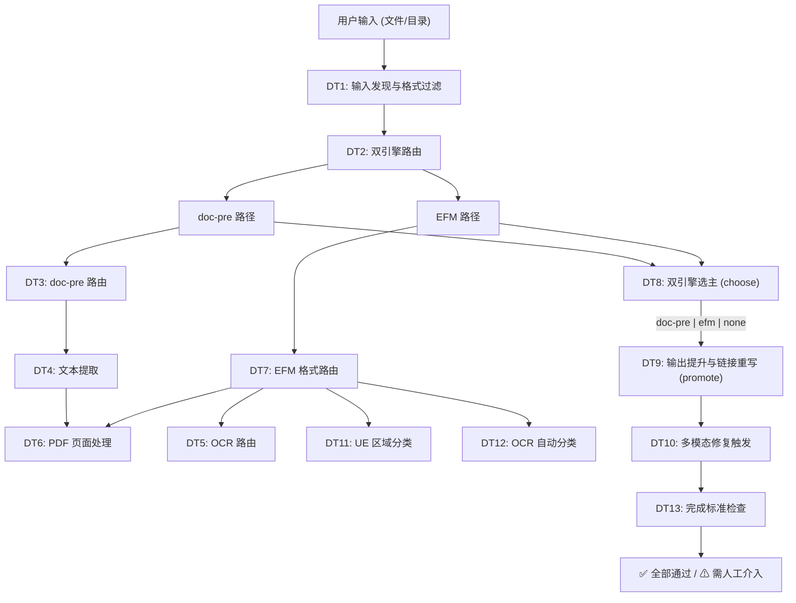

---

## DT1: 输入发现与格式过滤

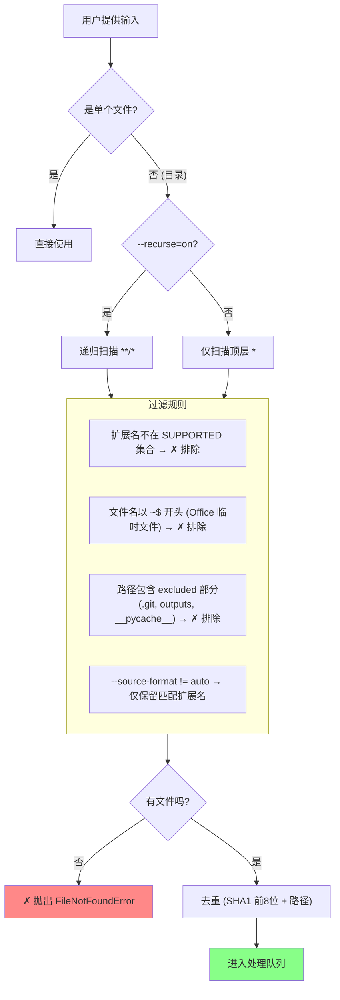

---

## DT2: 双引擎路由 (集成 Runner)

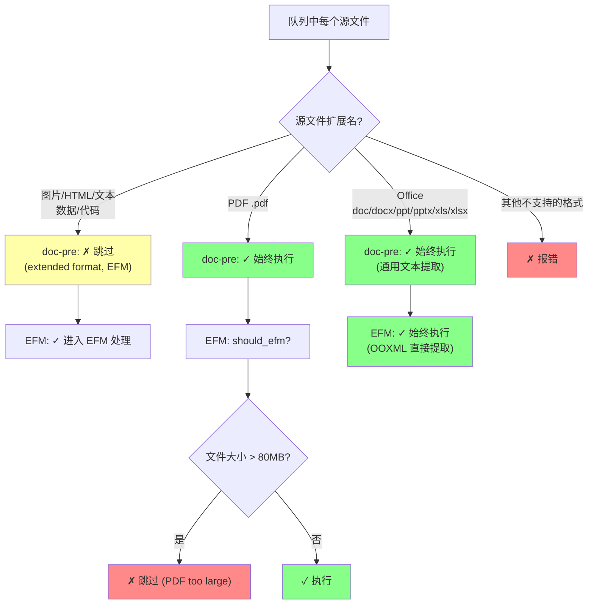

---

## DT3: doc-pre 引擎路由 (routing.py)

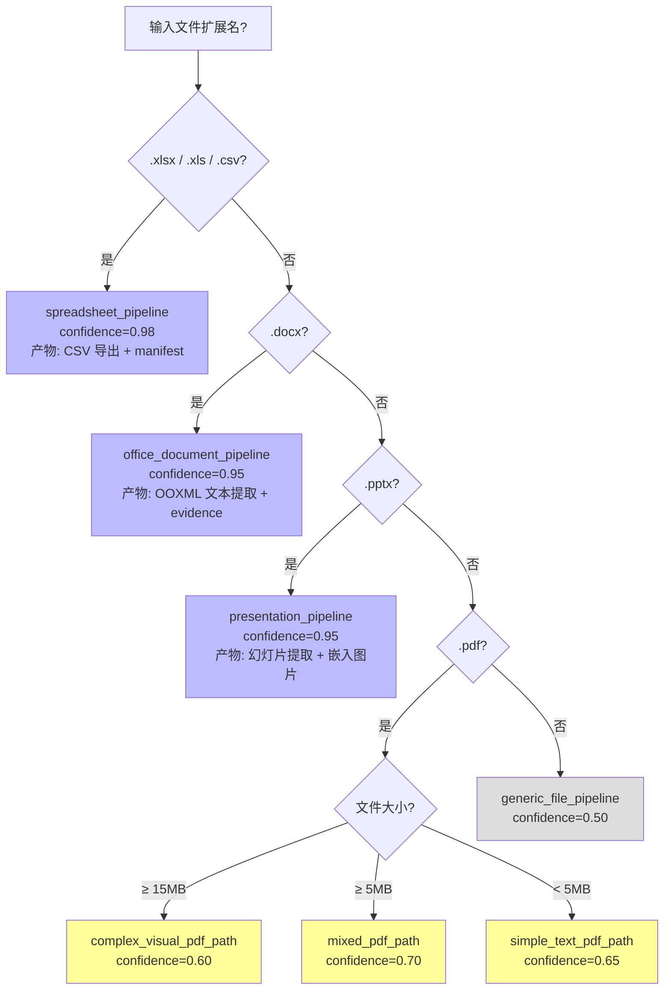

---

## DT4: doc-pre 文本提取 (Baseline Adapter)

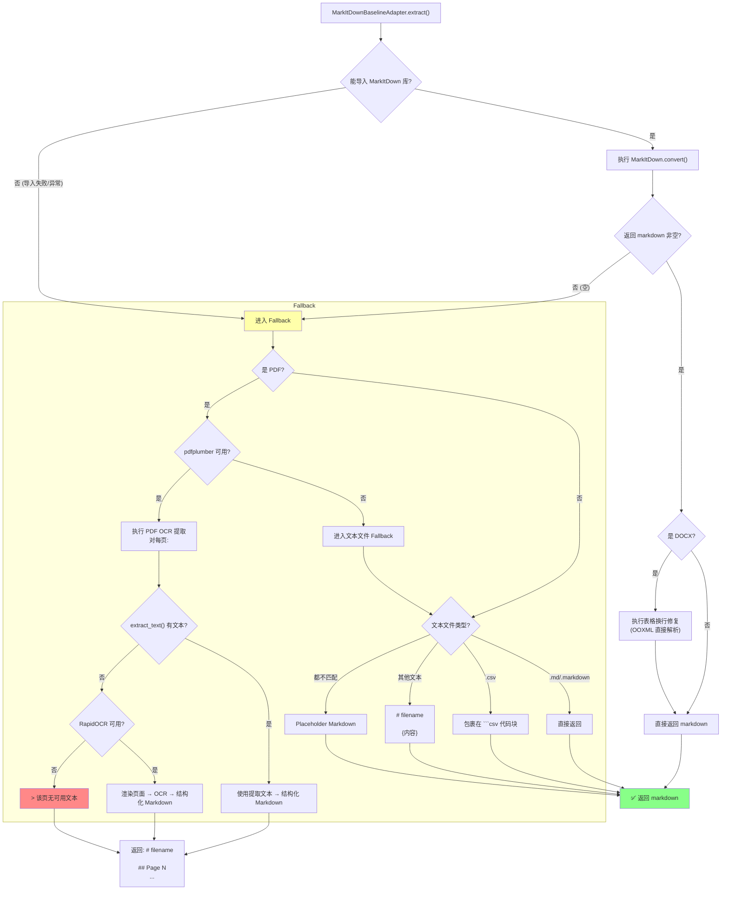

---

## DT5: 自适应 OCR 路由 (EFM)

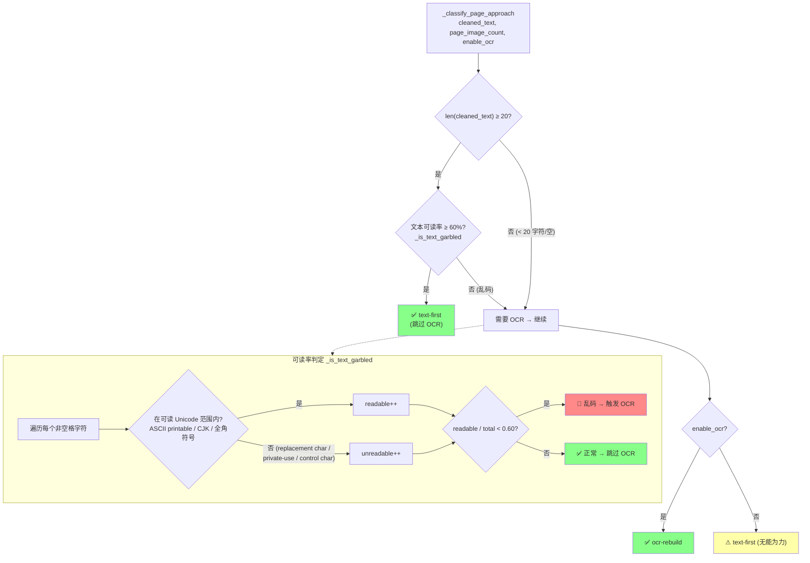

---

## DT6: PDF 页面处理 (EFM)

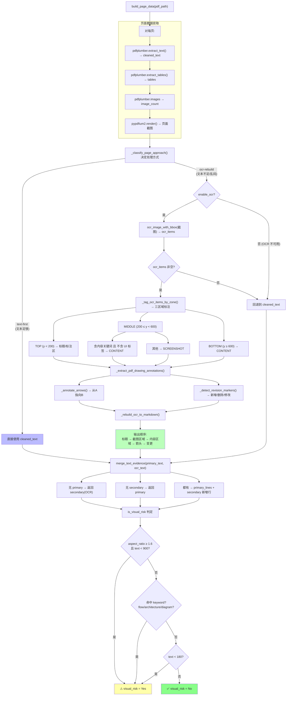

---

## DT7: EFM 格式路由 (bundle_runner.py)

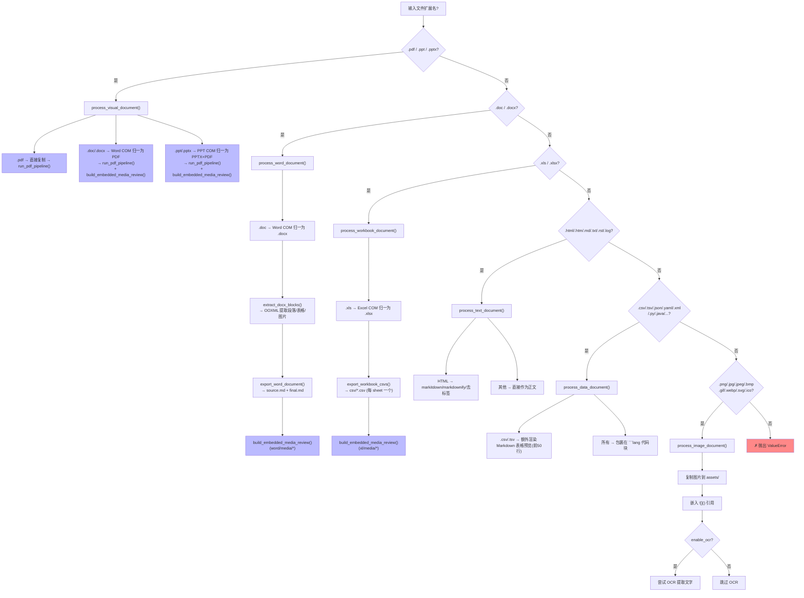

---

## DT8: 双引擎选主 (集成 Runner choose)

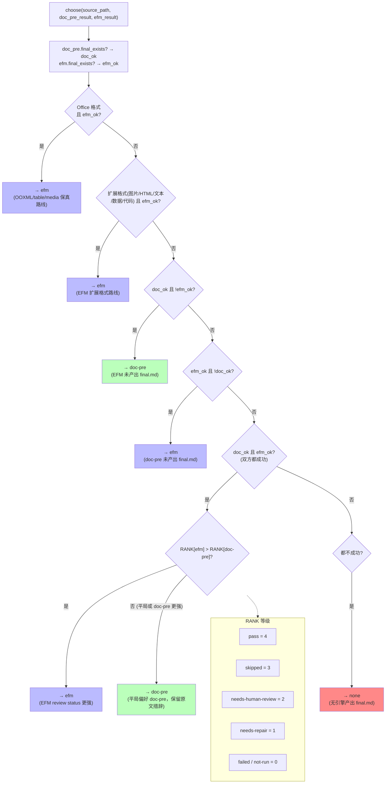

---

## DT9: 输出提升与链接重写 (promote)

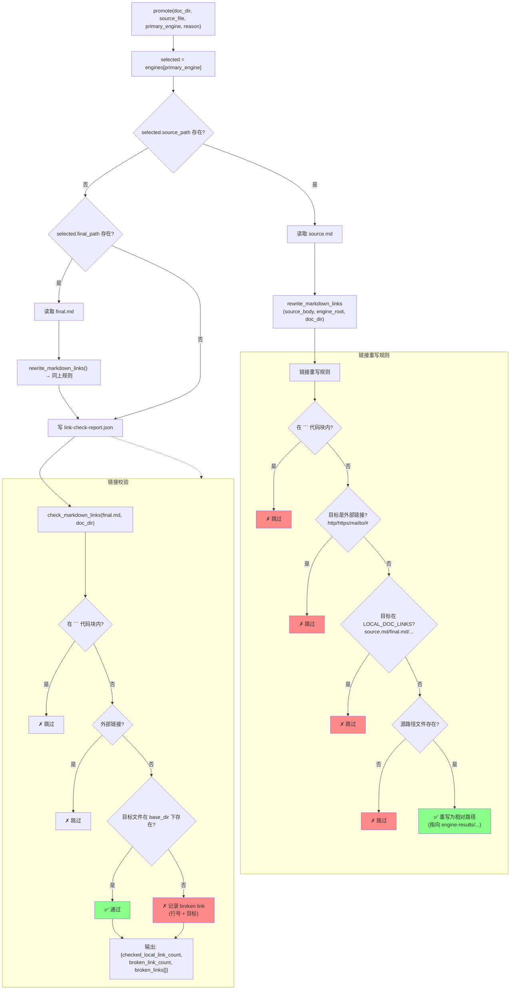

---

## DT10: 多模态修复触发 (Post-Pipeline)

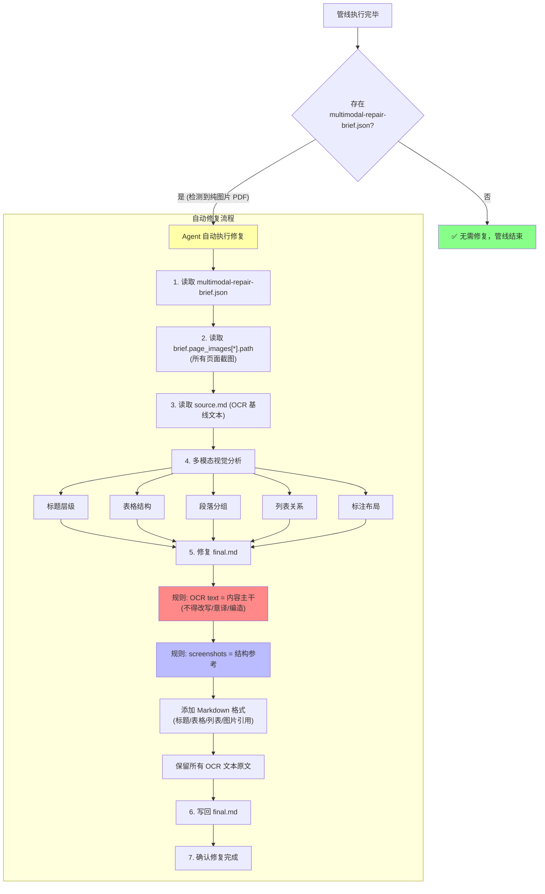

---

## DT11: UE 文档区域分类 (EFM)

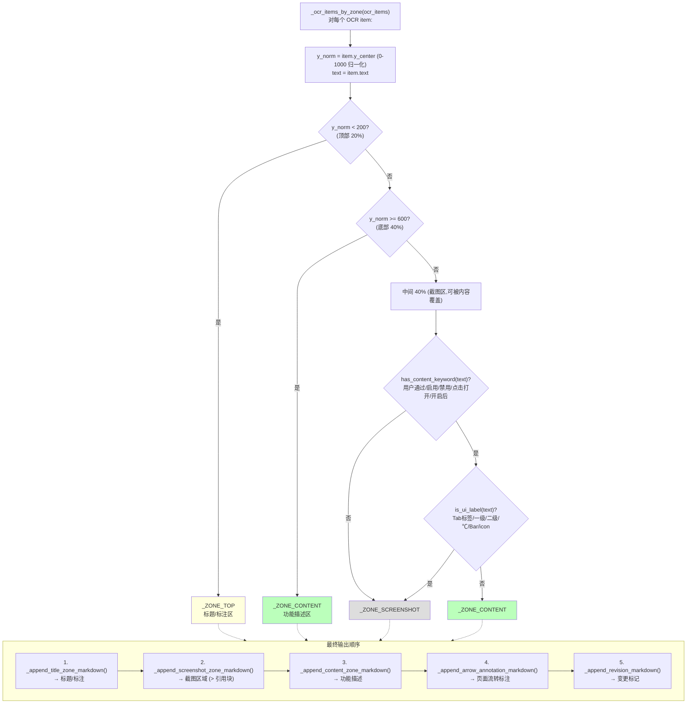

---

## DT12: EFM OCR 区域自动分类

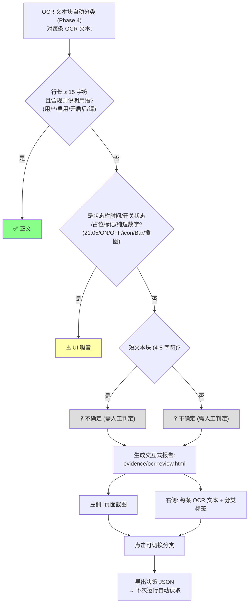

---

## DT13: 完成标准检查

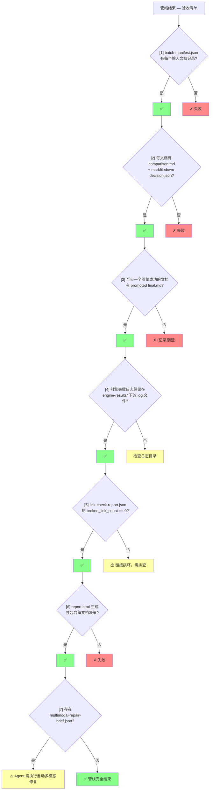
